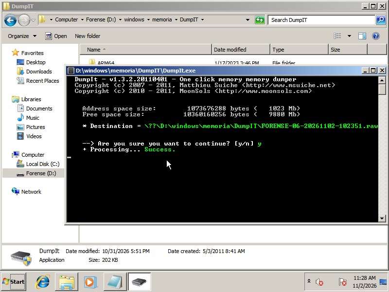
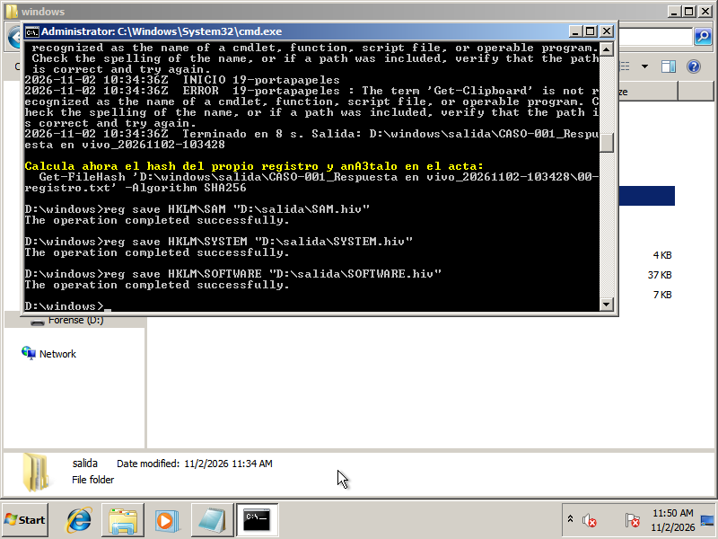
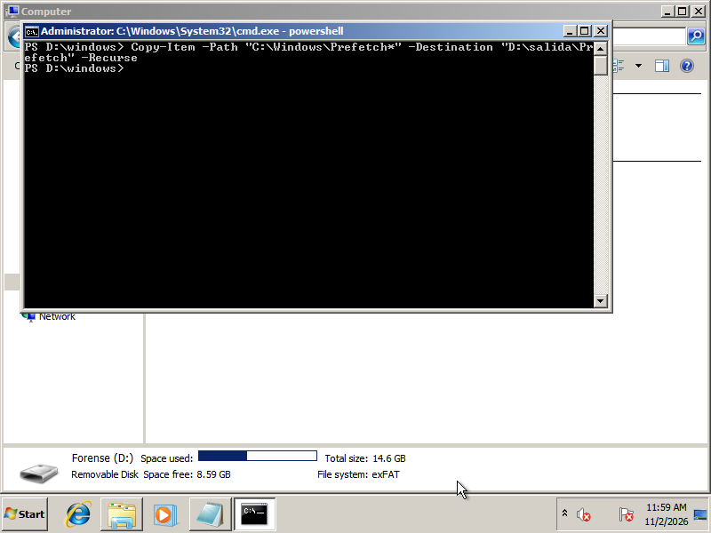
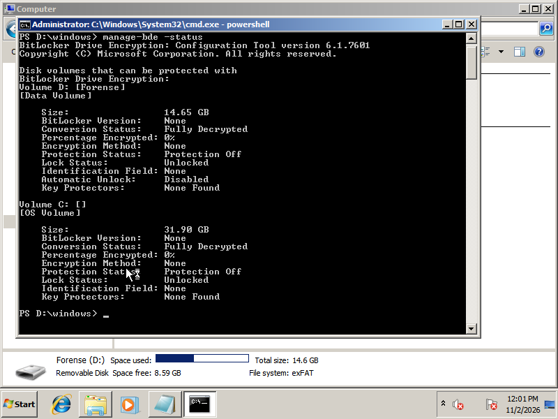
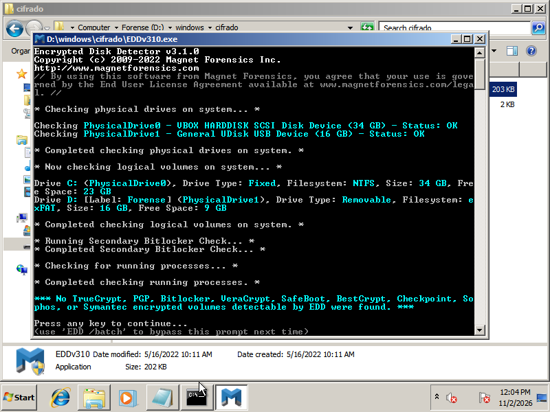

# Contexto

Llega el momento de adquirir de verdad. Un equipo encendido y comprometido, todo lo que se pierde si lo apagas y todo lo que hay que poder demostrar meses después. En este proyecto vas a recoger sus evidencias, en vivo y después en frío, y a custodiarlas sin dejar huecos. En la UD2 las analizarás.
# Resultados de aprendizaje y criterios

|RA|Criterio|
|---|---|
|RA1 · Aplica metodologías de análisis forense caracterizando las fases de preservación, adquisición, análisis y documentación|**b)** Se han utilizado los mecanismos y las herramientas adecuadas para la adquisición y extracción de las evidencias|
||**c)** Se ha asegurado la escena y conservado la cadena de custodia|

---
# El caso

Bahía Sistemas, la consultora que mantiene los equipos de Almadraba Diseño, ha detectado conexiones extrañas desde el ordenador del cuarto de informática, el que usan para administrar el resto. Sospechan que alguien lo ha comprometido y te piden que adquieras sus evidencias antes de tocar nada más. El equipo sigue encendido.

El técnico de Bahía te facilita la máquina y la cuenta de administrador:

- **Máquina virtual:** [FORENSIC_10.ova](https://drive.google.com/file/d/1UDMepBr5KpZeXdHgSFk4FwslMTWy5tSC/view) (unos 5 GB). Descárgala con tu cuenta de educaand e impórtala en VirtualBox.
- **Usuario:** `Administrador` · **Contraseña:** `HSrupaliuwCCvh`

---
# Antes de empezar
### Tu USB de respuesta

Todo lo que ejecutes saldrá de tu USB de respuesta, y todo lo que generes irá a él. Nunca al disco de la máquina investigada. Prepáralo como en [El laboratorio forense](https://ies-rafael-alberti.github.io/analisis-forense-26-27/ud1/laboratorio/#el-usb-de-respuesta): herramientas, sus hashes y una carpeta de salida.

- **Un pendrive o un disco duro USB**, conectado a la máquina virtual desde el menú de VirtualBox _Dispositivos → USB_. Necesitas al menos **16 GB libres**: el volcado de RAM ocupa tanto como la memoria de la máquina, y el triaje, otros pocos gigas.
- **Formatéalo en exFAT o NTFS**, nunca en FAT32: FAT32 no admite ficheros de más de 4 GB y el volcado de memoria se cortaría.
- **Si no tienes un USB con espacio suficiente**, añade a la máquina un segundo disco virtual en VirtualBox y úsalo como si fuera tu USB. Anótalo en el acta.
### Tu marca

Para demostrar que la adquisición es tuya, antes de empezar deja una marca en la máquina:

1. Abre el Bloc de notas, escribe tu marca con el formato `AFI-NombreApellido-AAAAMMDD` (por ejemplo, `AFI-MartaGarcia-20261020`) y **déjalo abierto, sin guardar**. Sin tildes, eñes ni espacios: así se encuentra sin problemas al buscarla.
2. Crea en el escritorio el fichero `marca-nombreapellido.txt` con el mismo texto.

Esa marca tiene que aparecer en tu volcado de memoria, en tu triaje y en tu imagen de disco. En un caso real no se escribe nada en el equipo investigado. Aquí es una excepción del ejercicio, y como cualquier acción sobre la evidencia, va la primera en tu acta, con su hora.

---
# Parte 1 · Adquisición en vivo

Con la máquina encendida, sigue el orden de volatilidad y anota la hora de cada paso:

1. **El estado inicial.** Captura de la pantalla, hora del sistema, hora real y desfase.
2. **La memoria RAM**, con DumpIt, y su hash.
3. **Los datos volátiles**, con el script [`respuesta-en-vivo.ps1`](https://ies-rafael-alberti.github.io/analisis-forense-26-27/ud1/scripts/respuesta-en-vivo.ps1).
4. **El tráfico de red.** Cáptalo desde fuera, como haría un TAP, sin instalar nada en la máquina. VirtualBox lo permite con la máquina en marcha (usa el nombre que tenga tu máquina en VirtualBox):
   ```bash
   VBOXManage controlvm "FORENSIC_10" nictracefile1 /ruta/caso/red.pcap
   VBoxManage controlvm "FORENSIC_10" nictrace1 on   # y "off" al terminar
   ```
5. **El triaje**, con KAPE o con un recolector _offline_ de Velociraptor.
6. **El cifrado.** Comprueba si hay volúmenes cifrados y, si los hay, actúa como se explica en los apuntes.
7. **El apagado.** Decide cómo apagar, hazlo y justifícalo.
## 1. Estado inicial


 Ambas fechas coinciden en la hora (*VM: 11:17 AM, Host: 11:17 AM*).
- ***10:17 UTC***
- 1 hora de desfase con la hora UTC.
## 2. Memoria (RAM)

Al ser una máquina *Windows 7 Professional*, las herramientas actuales de adquisición forense no servían debido a que sus versiones no eran compatibles con el sistema operativo. Por lo que se obtuvo la herramienta ***DumpIT v1.3.2.20110401***, con la cual se pudo realizar sin complicaciones la adquisición forense de la memoria RAM.

- **Start: DumpIT** --> 11:24 AM (10:24 UTC)
- **End: DumpIT** --> 11:28 AM (10:28 UTC)

## Respuesta en vivo
- **Start: respuesta-en-vivo.ps1 (modificado)** ---> 11:34 AM (10:34 UTC)
- **End: respuesta-en-vivo.ps1 (modificado)** ---> 11:35 AM (10:35 UTC)

## Trafico de red

- **Start: `VBoxManage`** ---> 11:41 AM (10:41 UTC)
- **End: `VBoxManage`** ---> 11:43 AM (10:43 UTC)


```bash
VBoxManage controlvm "FORENSIC_10" nictracefile1 /ruta/caso/red.pcap
VBoxManage controlvm "FORENSIC_10" nictrace1 on     # y "off" al terminar
```

>Se almacenó el tráfico en la máquina host para no desmontar el usb de la máquina sospechosa.
## Triaje

>No se pueden usar herramientas como KAPE o Velocirraptor, por lo que se procede a tomar todos los artefactos posibles de forma manual.
### Registros

- **Start: `reg save HKLM\SAM`** ---> 11:45 AM (10:45 UTC)
- **End: `reg save HKLM\SAM`** ---> 11:45 AM (10:45 UTC)

- **Start: `reg save HKLM\SYSTEM`** ---> 11:46 AM (10:46 UTC)
- **End: `reg save HKLM\SYSTEM`** ---> 11:47 AM (10:47 UTC)

- **Start: `reg save HKLM\SOFTWARE`** ---> 11:47 AM (10:47 UTC)
- **End: `reg save HKLM\SOFTWARE`** ---> 11:49 AM (10:49 UTC)


### Visor de eventos

- **Start: `wevtutil epl System`** ---> 11:55 AM (10:55 UTC)
- **End: `wevtutil epl System`** ---> 11:55 AM (10:55 UTC)

- **Start: `wevtutil epl Security`** ---> 11:55 AM (10:55 UTC)
- **End: `wevtutil epl Security`** ---> 11:55 AM (10:55 UTC)


### Prefetch

- **Start: `Copy-Item -Path "C:\Windows\Prefetch*" -Destination "D:\salida\Prefetch" -Recurse`** ---> 11:58 AM (10:58 UTC)
- **End: `Copy-Item -Path "C:\Windows\Prefetch*" -Destination "D:\salida\Prefetch" -Recurse`** ---> 11:59 AM (10:59 UTC)


### Tabla MFT

>No se pudo recuperar ya que debemos tener acceso al disco en crudo y herramientas como FTK Imager no podían ser usadas.
## Cifrado

Se comprobó si existía algún sistema de cifrado. Se ejecutó en primera instancia la herramienta ***manage-bde*** para tratar de identificar *Bitlocker*. Al ver que el disco no se encontraba cifrado mediante *Bitlocker* se usó la herramienta ***EDD*** para tratar de identificar algún otro sistema de cifrado. También dio negativo.

- **Start: `manage-bde -status`** ---> 12:01 AM (11:01 UTC)
- **End: `manage-bde`** ---> 12:01 AM (11:01 UTC)



>El disco no está cifrado mediante **BitLocker**.

- **Start: EDDv310** ---> 12:04 AM (11:04 UTC)
- **End: EDDv310** ---> 12:04 AM (11:04 UTC)



>El disco no está cifrado.

Al no identificar cifrado en el disco, se decidió realizar un apagado abrupto desde el hipervisor con la idea de no ejecutar *kill switches* que pudieran destruir evidencias.

---
# Parte 2 · Adquisición POST-MORTEM

>En esta parte adquieres dos evidencias: el disco de la máquina y el pendrive encontrado.
## El disco de la máquina

El disco de una máquina virtual ya es un fichero: no hace falta arrancar nada para adquirirlo. Se hace una imagen de ese fichero sin modificarlo, como se explica en [Discos virtuales](https://ies-rafael-alberti.github.io/analisis-forense-26-27/ud1/adquisicion-post-mortem/#discos-virtuales). Con la máquina investigada **apagada**:

1. **Documenta la máquina.** Anota qué discos tiene, si hay instantáneas y dónde está su carpeta (en VirtualBox, clic derecho sobre la máquina → _Mostrar en el explorador_).z
2. **Calcula el hash de cada fichero de esa carpeta**: el disco `.vmdk`, la configuración `.vbox` y los registros de `Logs/`.
3. **Haz la imagen del disco** y guárdala en tu disco de destino. Usa una de estas herramientas u otra que conozcas, y justifica en tus notas cuál has usado (cambia los nombres por los de tu disco):

|Sistema|Herramienta|Cómo|
|---|---|---|
|Windows|FTK Imager|_File → Create Disk Image → Image File_, elige el `.vmdk`, destino **E01** y marca _Verify images after they are created_.|
|Linux|`qemu-img`|`qemu-img convert -f vmdk -O raw disco.vmdk PC-ADMIN.raw` y después `sha256sum PC-ADMIN.raw`|
|macOS|`qemu-img` (con Homebrew: `brew install qemu`)|`qemu-img convert -f vmdk -O raw disco.vmdk PC-ADMIN.raw` y después `shasum -a 256 PC-ADMIN.raw`|

`dd` no sirve aquí: copiaría el fichero `.vmdk` tal cual, con su formato, no el disco que contiene.
4. **Vuelve a calcular el hash del `.vmdk`**: tiene que ser el mismo que en el paso 2. Si cambia, algo ha escrito en el original.
5. **Copia la configuración y los registros** (`.vbox` y `Logs/`) junto a la imagen y comprueba que sus hashes coinciden con los del paso 2.

El hash del `.vmdk` y el de la imagen **no coinciden, y es lo normal**: uno es el del fichero que contiene el disco y el otro, el del contenido del disco. Cada uno se compara consigo mismo: el `.vmdk`, antes y después; la imagen, con su verificación.
### 1. Documenta la máquina

La máquina `FORENSIC_10` cuenta con un único disco virtual de 32GB (`C:\Users\Pcx\VirtualBox VMs\FORENSIC_10\FORENSIC_10_disk0.vdi`), y no tiene ninguna instantánea.
### 2. Calcula el hash de cada fichero de la carpeta

Para calcular de forma automatiza el hash SHA256 de cada archivo del directorio y subdirectorios, podemos usar el siguiente comando:

```Powershell
Get-ChildItem -Path /ruta/al/directoio -File -Recurse | Get-FileHash

Algorithm       Hash                                                                   Path
---------       ----                                                                   ----
SHA256          8A55886B72A249EA6ADC193F5B70D0996CEDD227DB14034FBCA8D51C7FFCA706       C:\Users\Pcx\VirtualBox VMs\FORENSIC_10\FORENSIC_10.vbox
SHA256          A27C442DF06ADD281DA3CF9D4263F108DF61243E5F496902566A8BE08513CA0C       C:\Users\Pcx\VirtualBox VMs\FORENSIC_10\FORENSIC_10_disk0.vdi
SHA256          BED032C0B3501F08A00DF551C8E65154C5AF78412E9BC48C130A95209634B863       C:\Users\Pcx\VirtualBox VMs\FORENSIC_10\Logs\VBox.log
SHA256          A17F22C3592B2F284C3B29C9C1B7356F9DCF97665F1C775C7786367C225B7717       C:\Users\Pcx\VirtualBox VMs\FORENSIC_10\Logs\VBox.log.1
SHA256          612E49B2D6F7AF61F4FBF3B5CAAC1F3B87C75E4EBEE41E58A4E8E6F47AB753F9       C:\Users\Pcx\VirtualBox VMs\FORENSIC_10\Logs\VBox.log.2
SHA256          9ED1B5068CFE94350EAC44171B6583047F3CEB54B7F17185B74E188BEC1BDC2F       C:\Users\Pcx\VirtualBox VMs\FORENSIC_10\Logs\VBox.log.3
SHA256          92E176C01C7478957CF0D70731987CE99E3A536B0951D76827AC302BD237D7B6       C:\Users\Pcx\VirtualBox VMs\FORENSIC_10\Logs\VBoxHardening.log
```
### 3. Haz la imagen del disco y guárdala en tu disco de destino

Para la adquisición forense de la imagen del disco virtual se ha usado la herramienta `VBoxManage` con la opción `clonemedium disk` de la siguiente manera:

```Powershell
'C:\Program Files\Oracle\VirtualBox\VBoxManage.exe' clonemedium disk C:\Users\Pcx\VirtualBox VMs\FORENSIC_10\FORENSIC_10_disk0.vdi C:\Users\Pcx\Desktop\FORENSIC_10_disk.raw --format RAW
```

Con este comando adquirimos una copia *bit a bit* del disco virtual. Por lo que, lo que obtenemos tras este comando es un archivo de 32GB cuyo hash no concuerda con el hash del archivo `.vdi`.

>[!important]
>Como se usó un disco duro HDD externo conectado vía *USB2.0*, la adquisición se realizó en primera instancia al disco principal de la máquina forense. Una vez se adquirió el artefacto, se calculó su hash dando el siguiente resultado:
>
>```
>8A28EAAE66891B3BA0032244851B629251965796ED2C081F105F3FBB29821ACE
>```
>Tras obtener el Hash, se movió al disco externo y se volvió a corroborar el hash para asegurar que no han habido modificaciones.
>```
>8A28EAAE66891B3BA0032244851B629251965796ED2C081F105F3FBB29821ACE
>```
### 4. Vuelve a calcular el hash

Tras la adquisición forense de la imagen, se volvió a calcular el hash SHA256 del archivo `.vdi` para corroborar su integridad.

```Powershell
Algorithm       Hash                                                                   Path
---------       ----                                                                   ----
SHA256          A27C442DF06ADD281DA3CF9D4263F108DF61243E5F496902566A8BE08513CA0C       C:\Users\Pcx\VirtualBox VMs\FORENSIC_10\FORENSIC_10_disk0.vdi
```
### 5. Copia la configuración y los registros

>Copiamos el resto de archivos de la carpeta al disco externo.

---
## El pendrive encontrado

Antes de tocarlo, fotografíalo y anota marca, modelo, capacidad y número de serie, si lo tiene. Después, haz una **imagen E01** verificada con el bloqueo de escritura activo **antes de conectarlo**. Elige una de estas dos vías:

1. Arranca CAINE, desde un USB o en una máquina virtual, **antes** de conectar el pendrive. CAINE pone en solo lectura todo lo que se conecta.
2. Conecta el pendrive (en una máquina virtual, desde _Dispositivos → USB_) y comprueba con _UnBlock_ que está en solo lectura. Pon en escritura **solo** el disco de destino.
3. En Guymager, clic derecho sobre el pendrive → _Acquire image_ → **Expert Witness Format (EWF)**, con MD5, SHA-256 y _Verify image after acquisition_.
4. Guarda el fichero `.info` de Guymager junto a tus evidencias.
### Conectamos el pendrive

Cuando tenemos la máquina virtual con Caine ejecutándose, conectamos el pendrive a la máquina virtual y comprobamos que esté montado en solo lectura:


---
# Parte 3 · Busca tu marca

Tu marca tiene que aparecer en todas tus adquisiciones: es la prueba de que son tuyas. Búscala desde un Linux (CAINE, Kali…).

En la RAM:
```bash
strings -el PC-ADMIN-ram.dmp | grep "AFI-"     # -el: texto UTF-16, el que usa Windows
```

En el triaje no se copian los ficheros del escritorio, pero sí la tabla de ficheros de NTFS, `$MFT`, donde el nombre de tu fichero aparece en UTF-16:
```bash
strings -el '$MFT' | grep "marca-"`
```

En las imágenes del disco y del pendrive, móntalas en solo lectura y localiza tu fichero: en el escritorio del Administrador y en el pendrive.
## Marca en RAM


## Marca en Triaje

Por incompatibilidad de las herramientas de triaje, no se pudo sacar la tabla $MFT. No obstante, rastreamos la marca en el resto de artefactos obtenidos en la adquisición manual del triaje.


## Marca en Disco Virtual

Debido a que la imagen del disco virtual contiene todo el disco, también tenemos las particiones del mismo. Por lo que si tratamos de montar la imagen directamente con `sudo mount FORENSIC... ./disco` nos dará el siguiente error:

```
wrong fs type, bad option, bad superlock on /dev/loop1, missing codepage or helper program, or other error.
```

Esto ocurre debido a que el archivo `FORENSIC...` no es reconocido como un disco. Para solucionarlo podemos usar el siguiente comando:

```bash
sudo losetup --partscan --find --show FORENSIC...
/dev/loop1
```

Ahora, nuestro archivo se reconoce como un disco real y nos permite montarlo, formatearlo, etc. para ver las particiones del disco podemos usar la herramienta `lsblk`:

```bash
lsblk /dev/loop1

NAME      MAJ:MIN RM  SIZE RO TYPE MOUNTPOINTS
loop1       7:1    0   32G  1 loop 
|_loop1p1 259:0    0  100M  1 part
|_loop1p2 259:1    0 31,9G  1 part
```

Ahora si podemos montar el disco de la siguiente forma:

```bash
sudo mount -t ntfs-3g -r /dev/loop1p2 ./disco/
```
#### Marca en el escritorio

```bash
ls ./disco/Users/Administrator/Desktop
crea_user.py crea_user.txt desktop.ini marca-EstebanAlteroGarcia.txt.txt

cat ./disco/Users/Administrator/Desktop/marca-EstebanAlteroGarcia.txt.txt
AFI-EstebanAlteroGarcia-20261031
```


>[!important]
>*Las fechas de la marca del disco y la memoria RAM no coinciden en las fechas, debido a que el archivo se almacenó un día diferente al de la adquisición de las evidencias.*

## Marca en USB

Como la adquisición forense del pendrive se hizo con el formato E01, no podemos simplemente montarlo. sino que debemos seguir estos pasos:

```bash
# 1. Creamos dos puntos de montaje
sudo mkdir -p /mnt/e01 /mnt/datos2
## - e01: Expone el contendor E01
## - datos2: Monta los archivos finales

# 2. Exponemos la imagen RAW
sudo ewfmount /mnt/hdd/CEC/AFI/Practica AFI/pendrive.E01 /mnt/e01

# 3. Mapeamos la partición del pendrive
sudo losetup -Pf /mnt/e01/ewf1
```


```bash
# 4. Montamos los datos en Solo Lectura
sudo mount -t vfat -o ro /dev/loop2p1 /mnt/datos
```


